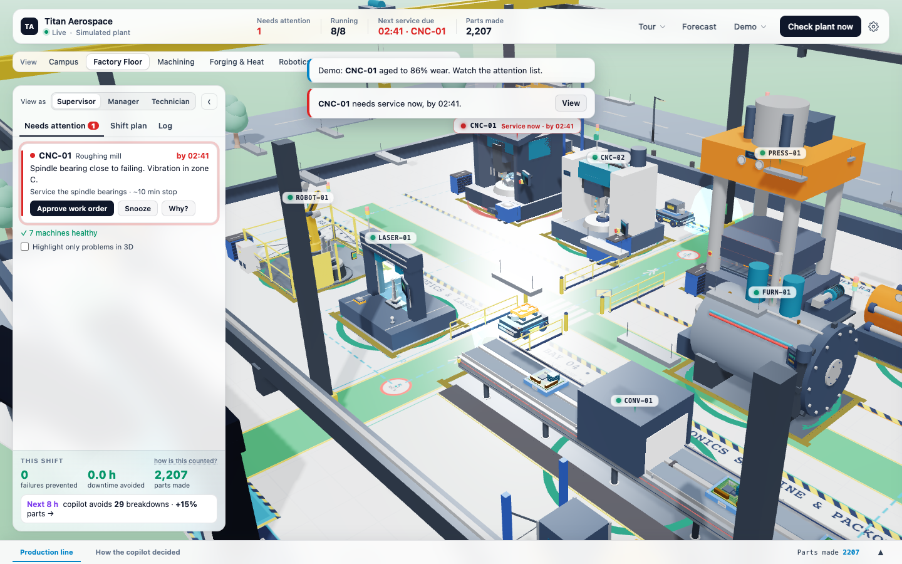
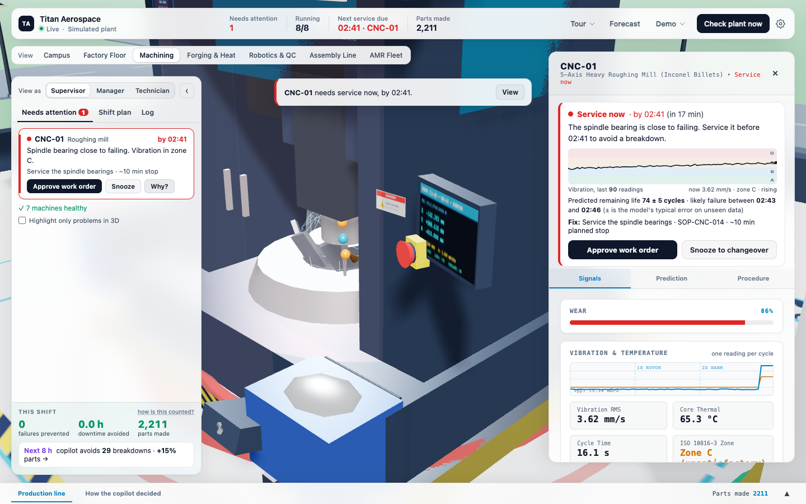
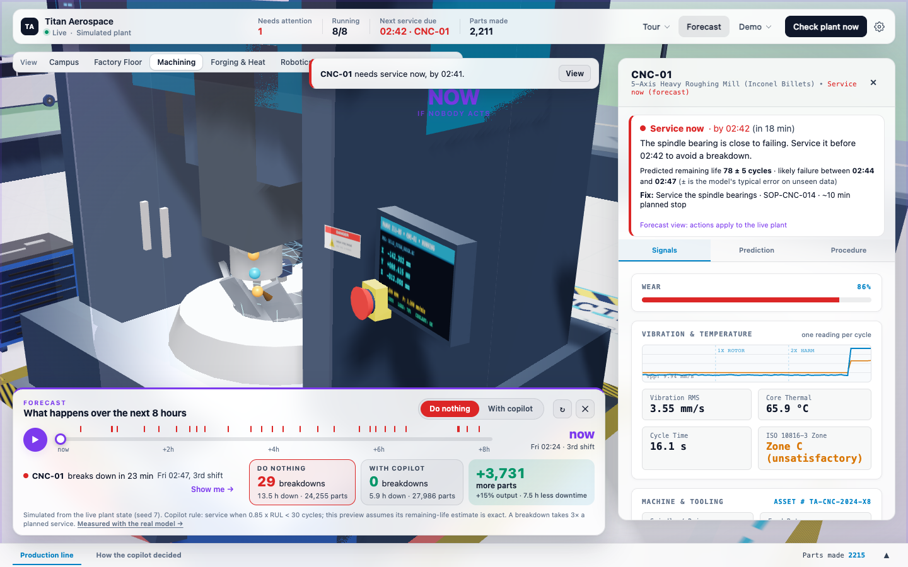
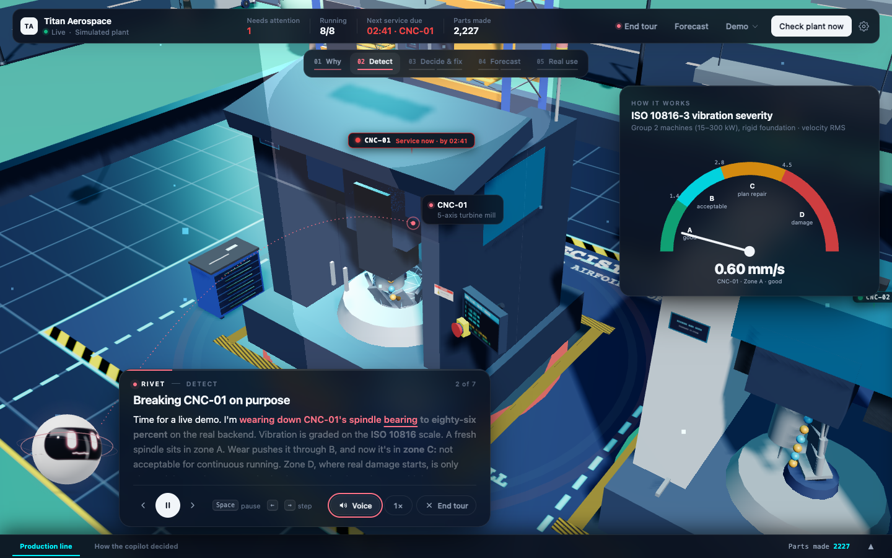
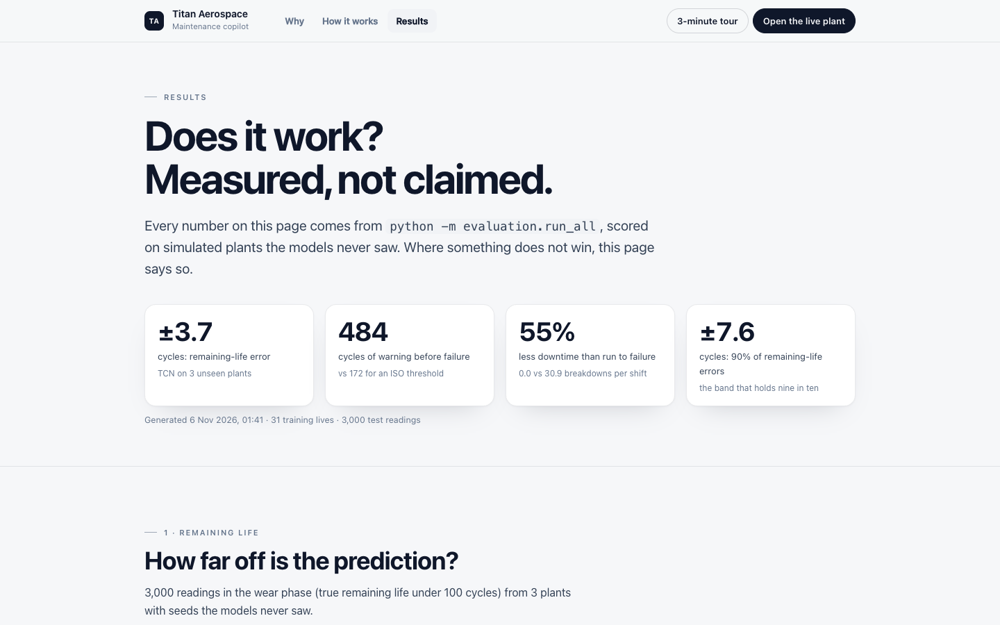

# Titan Aerospace Maintenance Copilot

**A digital twin of an aerospace machine shop, with models that predict which machine will fail and when, and a copilot that drafts the work order for a supervisor to approve.** Runs offline on one laptop or in the cloud.

[](https://render.com/deploy?repo=https://github.com/vishnu-0011/digital-twin-copilot)
&nbsp;
[](https://railway.app/template/new?template=https://github.com/vishnu-0011/digital-twin-copilot)



| | |
|---|---|
| **Problem** | Machines warn before they break, but plants act too late (run to failure) or on the wrong date (fixed schedules). |
| **Approach** | Simulated plant → anomaly detector + remaining-life model → rule-based agents → human approval → the twin is serviced. |
| **Measured** | ±3.7 cycles remaining-life error on unseen plants · 484 cycles of warning before failure (2.8× a fixed vibration limit) · 55% less downtime than run to failure |
| **Stack** | Python, SimPy, PyTorch, scikit-learn, LangGraph, ChromaDB, FastAPI, Three.js · 48 automated tests · no API keys |

While the server runs, three project pages tell the whole story:
[**Why**](web/why.html) (`/why.html`) · [**How it works**](web/method.html) (`/method.html`) · [**Results**](web/results.html) (`/results.html`).

---

## 1. The problem

A worn spindle bearing does not fail out of nowhere: vibration rises for hours or days first. Between the point where wear becomes detectable (P) and the breakdown (F) there is a window in which a repair can be planned. Plants usually miss it in one of two ways:

* **Run to failure.** Act after the breakdown: a long unplanned stop, and possibly a scrapped part.
* **Fixed schedule.** Service every N hours: healthy parts get replaced, and a fast-wearing machine can still break between visits.

The data to do better often exists, but it arrives as numbers ("3.1 mm/s, RUL 47 cycles") that nobody has time to turn into a decision. This project closes that gap: **which machine, what to fix, and by when**, with a person in charge.

## 2. What we built

| Step | What happens | Where |
|---|---|---|
| Sense | A SimPy twin of 8 machines emits a reading every cycle: vibration, temperature, part age. Streamed at 2 Hz over a WebSocket. | `digital_twin/`, `api/main.py` |
| Detect | An Isolation Forest learns the healthy envelope (first 80 cycles after each service) and flags the first departure from it. | `ml_pipeline/anomaly_detector.py` |
| Predict | A dilated temporal convolutional network reads the last 20 readings of the current part's life and estimates remaining life (RUL). | `ml_pipeline/tcn_model.py` |
| Decide | A LangGraph graph of rule-based agents: Monitor → Diagnosis (retrieves and cites the procedure) → Scheduler (0.85 × RUL < 30 cycles → draft a work order) → Report. | `agents/`, `rag/` |
| Fix | A supervisor approves the work order; the machine is serviced in the twin and returns to normal. Autonomy is opt-in (`COPILOT_AUTONOMY=1`). | `web/js/ops.js`, `POST /work-orders` |

The models only see what a real plant could measure. The simulator's wear level is never an input.

## 3. Results

Measured by `python -m evaluation.run_all` on plants the models never saw. Full tables: [`docs/RESULTS.md`](docs/RESULTS.md); charts: `/results.html`.

**Remaining life** (3,000 test readings in the wear phase)

| Model | MAE (cycles) | RMSE |
|---|---:|---:|
| TCN (deployed) | 3.68 | 4.63 |
| Gradient boosting (one reading) | 4.10 | 5.41 |
| Fleet-average life (no sensors) | 7.12 | 8.89 |

**Anomaly detection** (positive = wear has started)

| Detector | Precision | Recall | Median warning before failure |
|---|---:|---:|---:|
| Isolation Forest (deployed) | 0.952 | 0.995 | 484 cycles |
| ISO 10816 zone C threshold | 1.000 | 0.278 | 172 cycles |

**Maintenance policy** (10 plants × one 8-hour shift, same random wear for every policy)

| Policy | Breakdowns | Downtime (machine-hours) | Part life used |
|---|---:|---:|---:|
| Run to failure | 30.9 ± 0.7 | 14.23 ± 0.23 | 100% (breaks) |
| Fixed schedule (best: 95% of average life) | 0.0 ± 0.0 | 6.38 ± 0.14 | 95% |
| Copilot (TCN) | 0.0 ± 0.0 | 6.43 ± 0.13 | 94% |
| Copilot (perfect model, upper bound) | 0.0 ± 0.0 | 6.42 ± 0.13 | 95% |

**Real-data benchmark.** `evaluation/cmapss_benchmark.py` trains the same TCN architecture on NASA's public C-MAPSS FD003 turbofan data and scores it on the official 100 test engines against ridge regression, a random forest and published results. It is not part of the default run (about 30 minutes on a laptop CPU): `python -m evaluation.run_all --cmapss-only`.

What these say, honestly:

* The TCN beats a single-reading model and a no-sensor baseline on the twin, so the reading history matters.
* The copilot removes the breakdowns that running to failure causes (55% less downtime).
* A fixed schedule tuned on the test plants themselves matches it (marginally better, by 0.05 h per shift), because simulated parts wear predictably. But its optimum sits next to a cliff (100% of average life gives 19.8 breakdowns per shift), and finding it needed knowledge a real plant does not have. The copilot gets there without tuning. Whether it pulls ahead where wear varies more is untested here.

## 4. Run it

```bash
python3 -m venv venv && source venv/bin/activate      # Windows: venv\Scripts\activate
pip install -r requirements.txt
uvicorn api.main:app --port 8000                      # open http://localhost:8000
```

The first start trains both models (about 2 minutes on a laptop CPU) and caches them in `.model_cache/`; later starts take a few seconds. Changing training code retrains automatically, and `TWIN_RETRAIN=1` forces it. Optional settings are listed in `.env.example`; no API keys are needed.

```bash
python -m unittest discover -s tests -p "test_*.py"   # 48 tests
python -m evaluation.run_all --quick                  # about 8 min; --cmapss-only adds C-MAPSS
```

## 5. Using the app

* **Needs attention** (left): the copilot's to-do list, ranked, each with a plain reason, the fix, and a deadline in clock time. **Approve work order** puts the machine into service; **Snooze** hides it until the next shift change.
* **One status ladder everywhere**: Healthy → Watch → Service soon → Service now → Down (+ In service).
* **Click a machine**: the drawer answers first (verdict and deadline), then shows the vibration trend over the ISO 10816-3 zones, the prediction with its error range, and the procedure steps.
* **Forecast**: run the plant 8 hours ahead with and without the copilot and scrub through it.
* **Check plant now**: runs the agent graph; flagged machines get draft work orders.
* **Views**: Supervisor, Manager (impact and shift plan), Technician (jobs and procedures).
* **Tour**: a narrated 3-minute or 9-minute guided tour; it also links the Why, How it works and Results pages.
* **Demo**: controls that exist only because the plant is simulated (fast-forward, wear out a machine, reset).

| | |
|---|---|
|  |  |
|  |  |

## 6. Repository

```
digital_twin/   SimPy plant, forecast (run the plant forward), ISO 10816-3 zones
ml_pipeline/    features, anomaly detector, TCN, training data, model cache, dataset loaders
agents/         LangGraph graph: monitor, diagnosis, scheduler, report
rag/            procedure documents (one per machine type) and the ChromaDB knowledge base
api/            FastAPI: REST, WebSocket stream, static web app
web/            3D operations view (Three.js), project pages, results data
evaluation/     metrics, twin evaluation, policy evaluation, C-MAPSS benchmark
tests/          48 unit and integration tests
data/CMaps/     NASA C-MAPSS turbofan data (public), used by the benchmark
docs/           RESULTS.md, VIVA.md, screenshots, project history
scripts/        screenshot and video capture helpers
dashboard/      optional Streamlit dashboard (older, simpler front end)
```

Team primer: [`About.md`](About.md). Likely examiner questions, with answers: [`docs/VIVA.md`](docs/VIVA.md).

## 7. Limitations

* The plant is simulated, with hand-chosen degradation curves; no real machine has been connected.
* Models trained on the simulator are not validated on real machines. A benchmark of the architecture on NASA C-MAPSS data is included (`--cmapss-only`) but not yet in this report.
* A breakdown is assumed to take 3× a planned service to repair; the Results page shows the sensitivity to that assumption.
* The live forecast in the UI assumes a perfect remaining-life estimate, for speed. The measured version, with the real model, is in Results.
* Industry savings figures (US DOE FEMP, 2010) describe predictive maintenance in general, not this project.

## 8. References

1. A. Saxena, K. Goebel, D. Simon, N. Eklund. Damage propagation modeling for aircraft engine run-to-failure simulation. PHM08, 2008.
2. S. Bai, J. Z. Kolter, V. Koltun. An empirical evaluation of generic convolutional and recurrent networks for sequence modeling. arXiv:1803.01271, 2018.
3. A. Lövberg. Remaining useful life prediction of aircraft engines with variable length input sequences. Annual Conference of the PHM Society, 2021.
4. F. T. Liu, K. M. Ting, Z.-H. Zhou. Isolation forest. IEEE ICDM, 2008.
5. ISO 10816-3:2009. Mechanical vibration: evaluation of machine vibration by measurements on non-rotating parts, part 3.
6. F. O. Heimes. Recurrent neural networks for remaining useful life estimation. PHM08, 2008.
7. G. S. Babu, P. Zhao, X.-L. Li. Deep convolutional neural network based regression approach for estimation of remaining useful life. DASFAA, 2016.
8. S. Zheng, K. Ristovski, A. Farahat, C. Gupta. Long short-term memory network for remaining useful life estimation. IEEE ICPHM, 2017.
9. X. Li, Q. Ding, J.-Q. Sun. Remaining useful life estimation in prognostics using deep convolution neural networks. Reliability Engineering & System Safety 172, 2018.
10. J. Moubray. Reliability-centered Maintenance, 2nd ed., 1997.
11. US DOE FEMP. Operations & Maintenance Best Practices Guide, Release 3.0, 2010.

## License

MIT.
